# Плейтест 2026-11-11 (Android)

**Устройство:** realme RMX3867, Android 16, экран 1080x2400 (Unity рисует 1080x2333, вырез 110 px).
**Сборка:** Development Build, debug-подпись, `develop` @ `fc1fe6b7` + фикс туториала (см. «Исправлено»).
**Что пройдено:** уровни 1–3 вручную, 4–5 читом «Победа», 6 (туториал сачка); поражение и «Ещё 5 ходов» за кристаллы; реклама «+20 💎»; меню, регионы, постройка, магазин (бустер за кристаллы, IAP), задания, ежедневные награды, настройки, пауза, кнопка «Назад».
**Ошибок/исключений Unity в logcat за сессию нет.**

Приоритет: 🔴 высокий · 🟠 средний · 🟡 низкий (визуал).

---

## 🔴 1. В Development-сборке показывается настоящая реклама

Rewarded «+20 💎» показал живое объявление Unity Ads (не тестовое). Клики/показы с тестового телефона по живой рекламе — риск бана аккаунта сети за invalid traffic.

- Код: `Assets/Scripts/Services/Ads/IronSourceManager.cs:82-98` — в dev-сборке вызывается только `LevelPlay.ValidateIntegration()`, тестовый режим/тестовые устройства не включены.
- GDD §8.4: «`ValidateIntegration` / тест-сьют — только в debug-сборках».
- Что сделать: добавить тестовое устройство в дашборде LevelPlay (и Unity Ads test mode для него) и/или включить тест-сьют в `#if DEVELOPMENT_BUILD`.

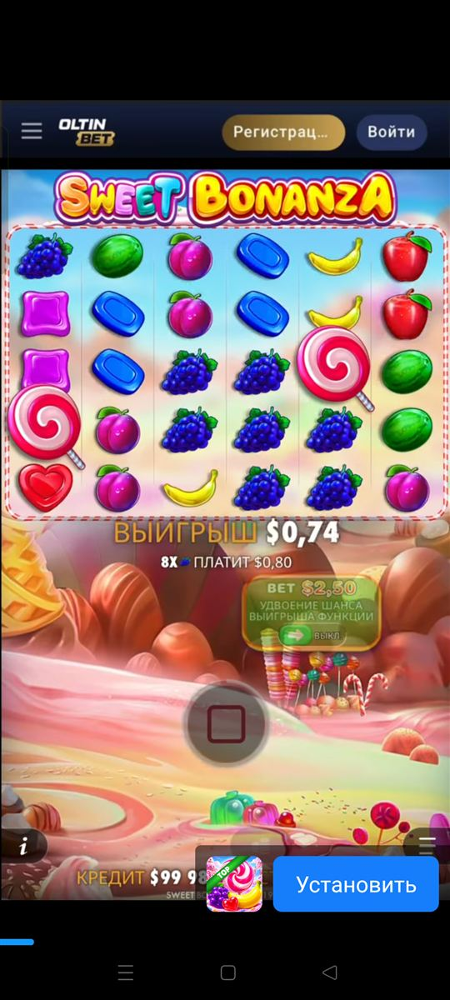

## 🔴 2. Реклама казино, букмекеров и форекса

За 10 минут: казино-слот «Oltin Bet / Sweet Bonanza» (rewarded), баннеры «PARI фрибет 5x1000₽» (букмекер) и «Libertex» (форекс, с предупреждением о рисках). Для казуальной игры 3+ это риск для рейтинга и политики Google Play.

После ролика реклама сама открыла карточку приложения в Google Play (я не нажимал), затем показала end card без видимого крестика — закрылась только системной кнопкой «Назад».

- Что сделать: в LevelPlay / Unity Ads заблокировать категории Gambling, Real-money gaming, Financial/Trading; выставить максимальный контент-рейтинг рекламы (G / Everyone).

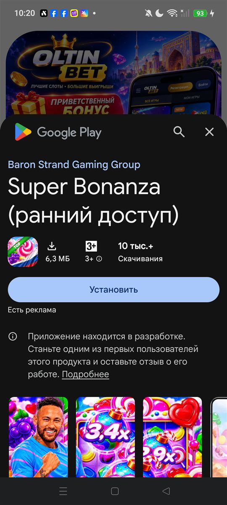  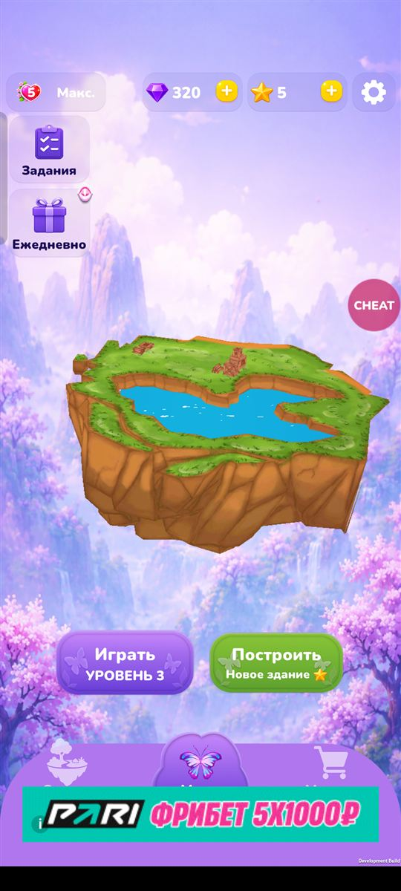

## 🔴 3. Баннер перекрывает нижнюю навигацию меню

Баннер (GDD §8.3: только в меню, снизу) ложится поверх нижней панели: подписи «Остров / Меню / Магазин» закрыты на всех трёх экранах, низ попапов (панель читов) тоже. Появляется сразу после выхода в меню после уровня 2.

- Код: баннер создаётся в `IronSourceManager.RegisterBanner` (`respectSafeArea: true`), показ — `SetBannerAllowed` из `SceneLoader`. Навигация (`MenuPager` / HUD Overlay) про высоту баннера не знает.
- Что сделать: при показе/скрытии баннера (`OnAdDisplayed` / `HideAd`) поднимать нижнюю панель на высоту баннера (или резервировать полосу под баннер в меню).

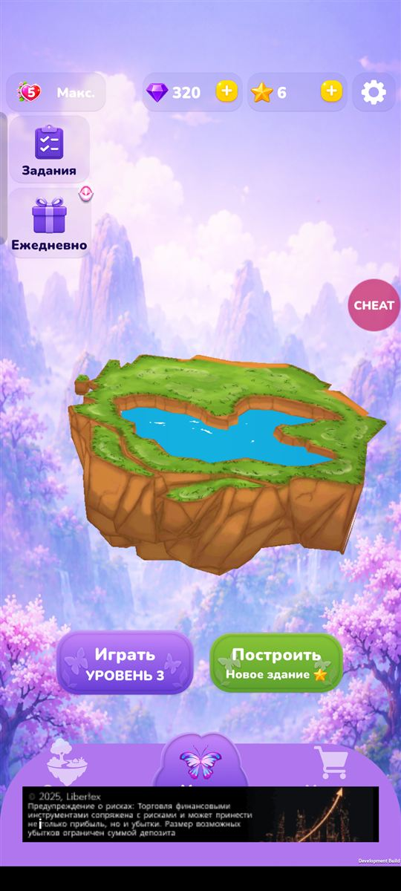 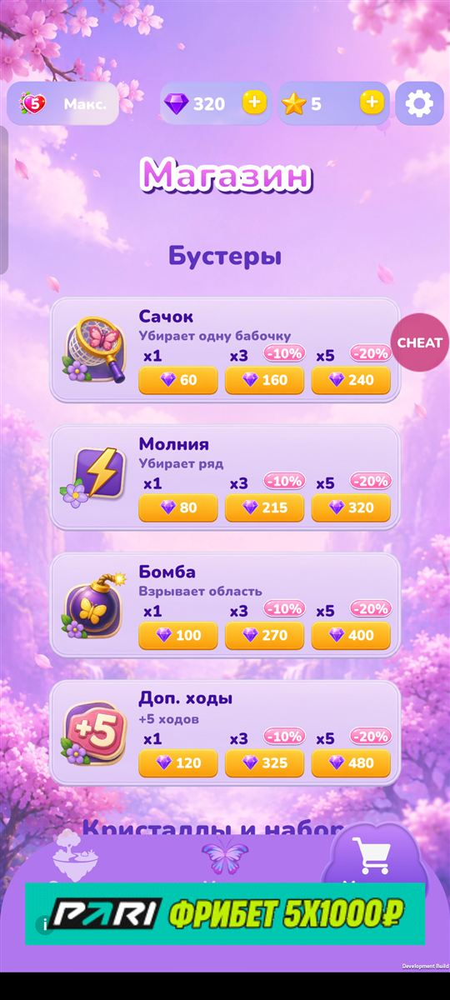

## 🟠 4. Магазин: 17 из 18 IAP недоступны, цены — заглушки, покупка молча не работает

- У «Без рекламы» цена из Google Play (**35 880,00 UZS**), у всех остальных — захардкоженные **$0.99…$49.99**. Валюты на одном экране разные.
- Нажатие на товар с заглушкой ничего не делает: ни тоста, ни ошибки. В логе:
  `[InAppPurchasingService] CrystalsStarter failed: Not purchasing product, either is not found or is not available for purchase`.
- При старте: `Unavailable product` для `crystals_*`, `starter_bundle`, `beginner_bundle`, `builder_bundle`, `master_bundle`, `hard_level_offer`, `need_moves_offer`, `out_of_lives_offer`, `daily_*_offer` и др. Значит, в Play Console они не созданы/не активны (или ID не совпадают).
- Что сделать: завести товары в Play Console; в `CountryShopBinder.HandlePurchaseInApp` при неуспехе показывать тост (как «Реклама недоступна»), а товар без цены из стора — скрывать или блокировать.

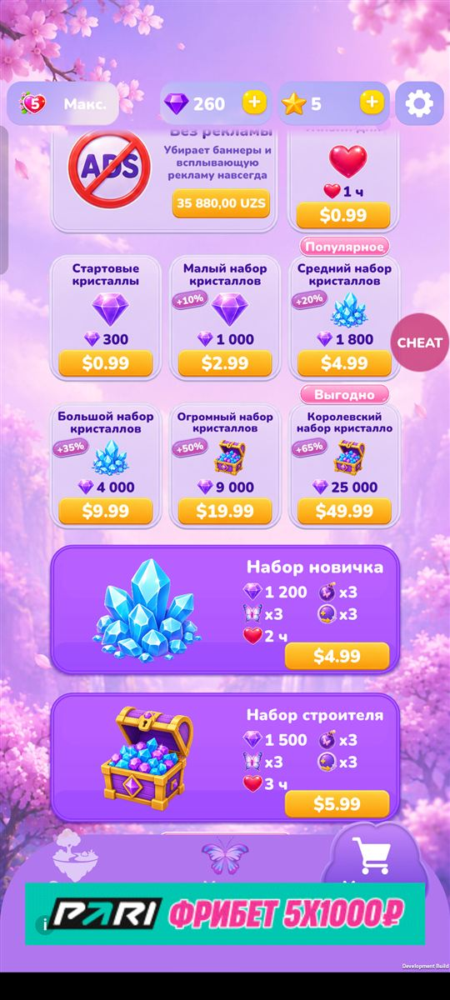

## 🟠 5. Системная кнопка «Назад» не работает

- В паузе — окно не закрывается (`MenuPausePopup`: `closesOnEscape: false`).
- На уровне без попапа — пауза не открывается (обработки нет).
- В меню попап «Задания» не закрывается.
- Код: единственная обработка — `Assets/JuiceFresh/Scripts/GUI/AnimationManager.cs:52` (`Input.GetKeyUp(KeyCode.Escape) && Behaviour.ClosesOnEscape`); новые меню-попапы (`CurvedUIPanelAnimator`) её не используют.

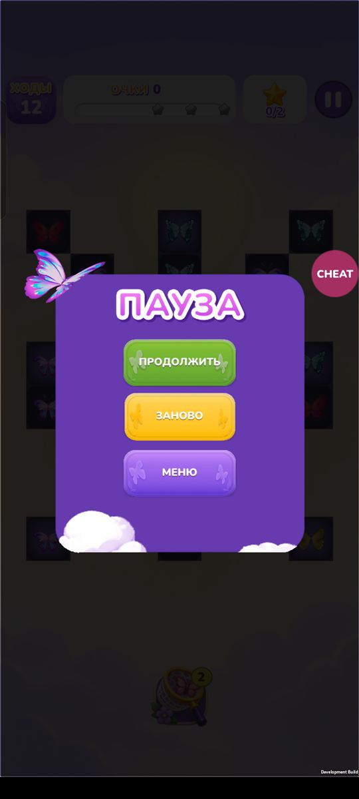 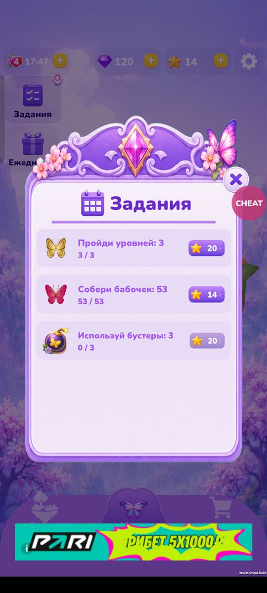

## 🟠 6. Запрос разрешения на уведомления появляется поверх первого шага туториала

Системное окно «Разрешить приложению ButterflyMatch отправлять уведомления?» всплывает при входе в уровень 1 и закрывает поле на шаге «Проведи пальцем…». Новичку лучше спрашивать позже (после первой победы / в меню).

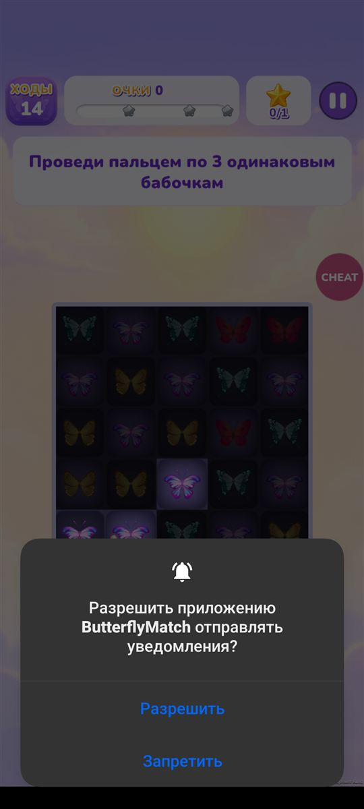

## 🟠 7. Бустер не засчитывается в задание, если уйти с уровня

На уровне 6 применил сачок (3 → 2), вышел через «Пауза → Меню». Задание «Используй бустеры: 3» осталось 0/3, при этом жизнь списана.

- Код: `Assets/Scripts/Initializers/Game/LevelOutcomeTracker.cs:50,63` — `TrackCollectedAndBoosters()` вызывается только при победе/поражении, выход с уровня не учитывается.

---

## 🟡 Визуальные мелочи

| # | Где | Что | Скрин |
|---|---|---|---|
| 8 | Ежедневно | Бейдж «Сегодня» над «День 1» обрезан сверху | 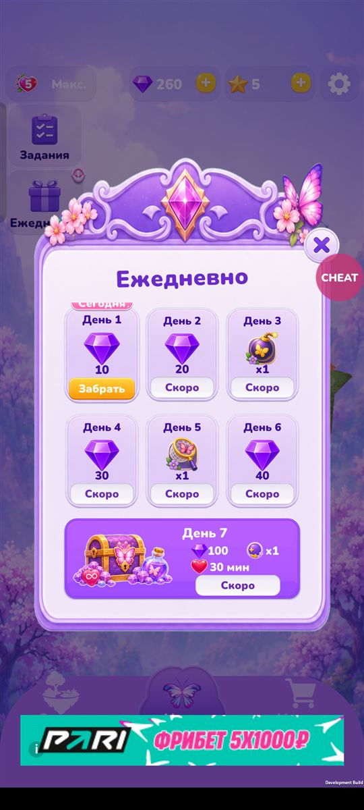 |
| 9 | Магазин | «Королевский набор кристалло» — название обрезано |  |
| 10 | Победа | После просмотра «+20 💎» кнопка исчезает и остаётся пустая дыра между «Награда» и «Меню/Далее» | 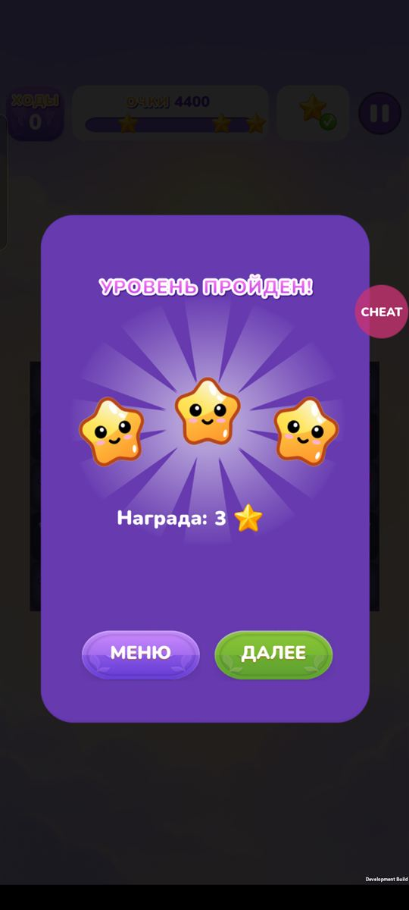 |
| 11 | Постройка (Япония) | «Молодая», «Цветущая» и «Старая сакура» — одна и та же иконка | 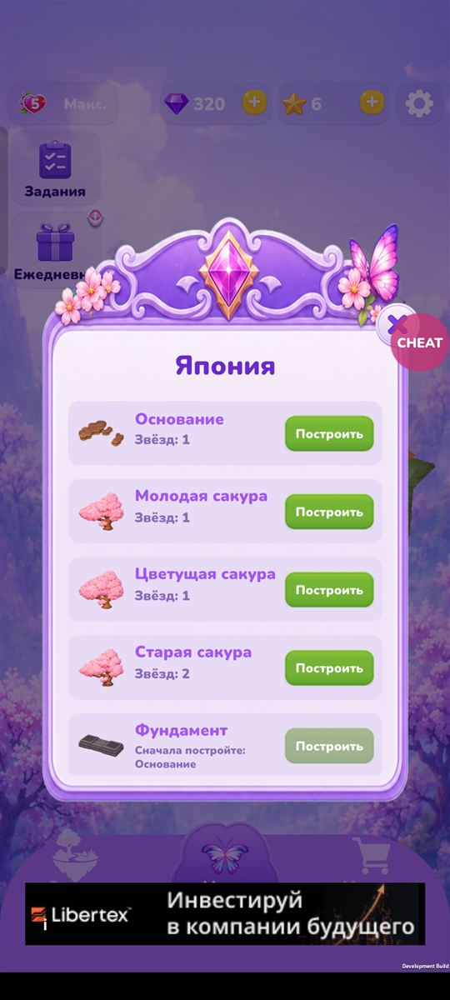 |
| 12 | Задания | В плашке награды за числом обрезанный значок («20» + кусок иконки) | 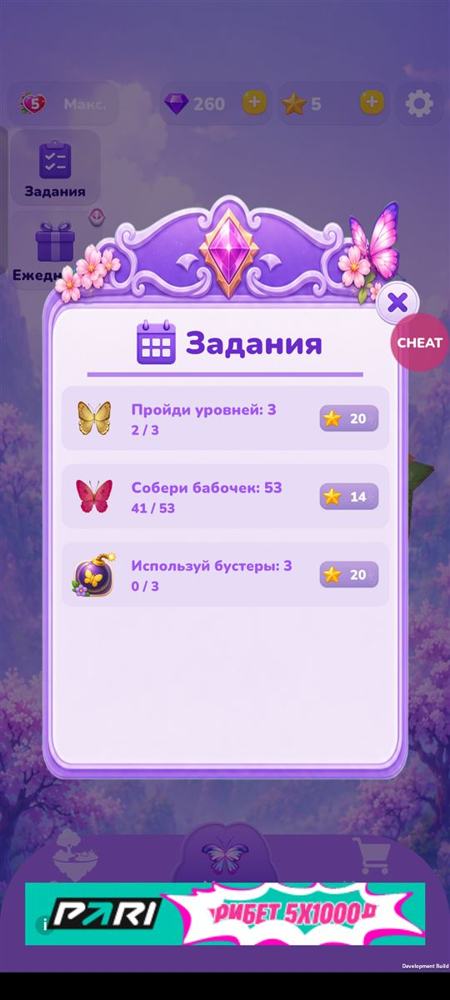 |
| 13 | Пауза | Облака внизу окна обрезаны ровной линией; стиль окна отличается от остальных попапов |  |
| 14 | Поражение | Большая пустота над кнопками; предложение «Ещё 5 ходов» стоит ниже «Заново/Домой» | 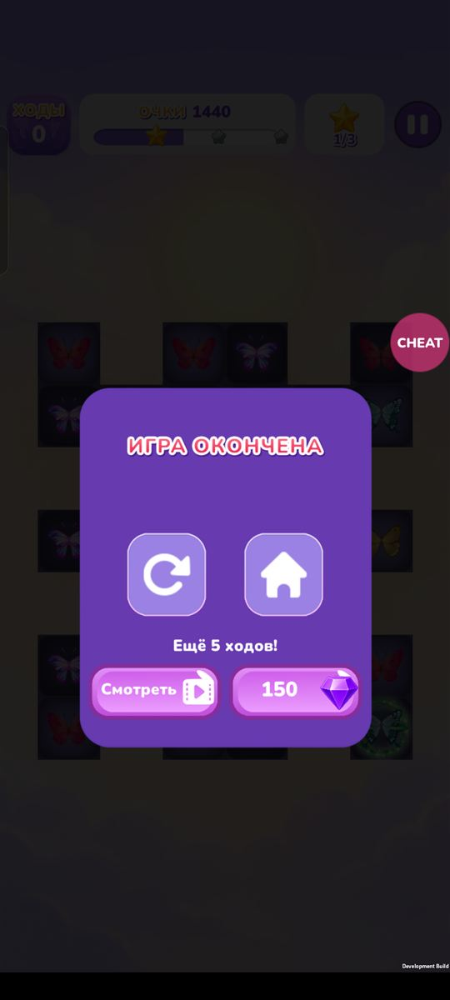 |
| 15 | Награда за рекламу | Попап награды поверх экрана победы: два затемнения, фон почти чёрный | 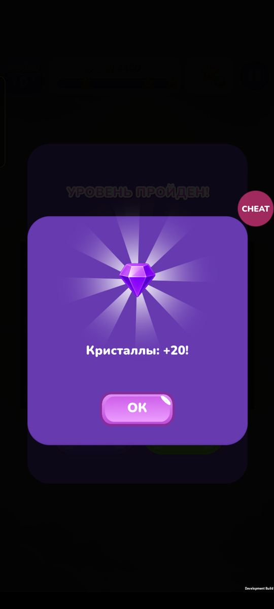 |

## Вопросы к балансу (не баги, проверить по GDD)

- Очки линейные: 80 за бабочку при любой длине цепочки (3 → 240, 5 → 400, 8 → 640, 9 → 720). Бонуса за длину нет, хотя туториал говорит «чем длиннее цепочка, тем больше очков».
- Задания дают 14–20 ⭐, уровень — до 3 ⭐, постройка стоит 1–2 ⭐. Одно задание = ~7 уровней.
- Уровень 4: 8 ходов на 8 красных + 8 жёлтых, на стартовом поле 3 красных. Вручную не проходил (читом), стоит прогнать `AutoPlayBot`.

## Сборка

- В отчёте сборки ошибка: `Broken text PPtr in file(Assets/JuiceFresh/Scenes/main.unity). Local file identifier (1304310000) doesn't exist!` — сборке не мешает, но в `main.unity` битая ссылка.

## Не баги

- Серая полупрозрачная полоска у левого края на всех экранах — системная панель ColorOS «Игровой ассистент» (`com.oplus.games`, окно `GameFloatBarView`), не игра.
- Кнопка CHEAT перекрывает крестик попапов и правую верхнюю клетку поля — только в Development-сборке.

## Исправлено в этой сессии

- Облако туториала налезало на поднятый счётчик ходов и панель очков на экранах с вырезом. Теперь облако ставится под нижний край верхней панели (`TutorialOverlay.ShowMessage(..., under)`), проверено на телефоне (уровни 1, 2, 4).

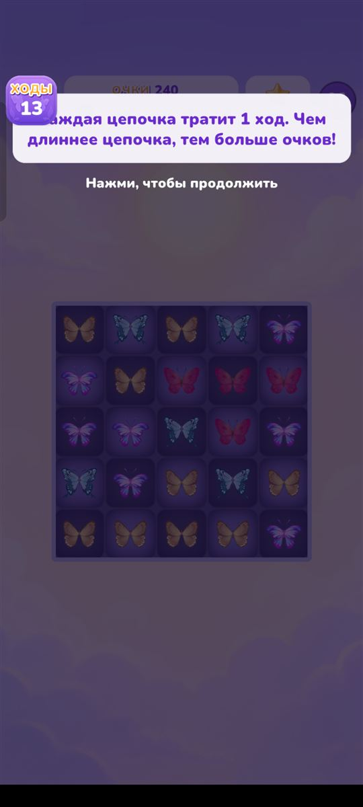 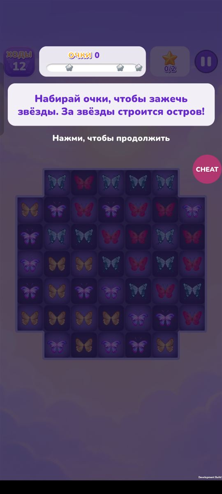
